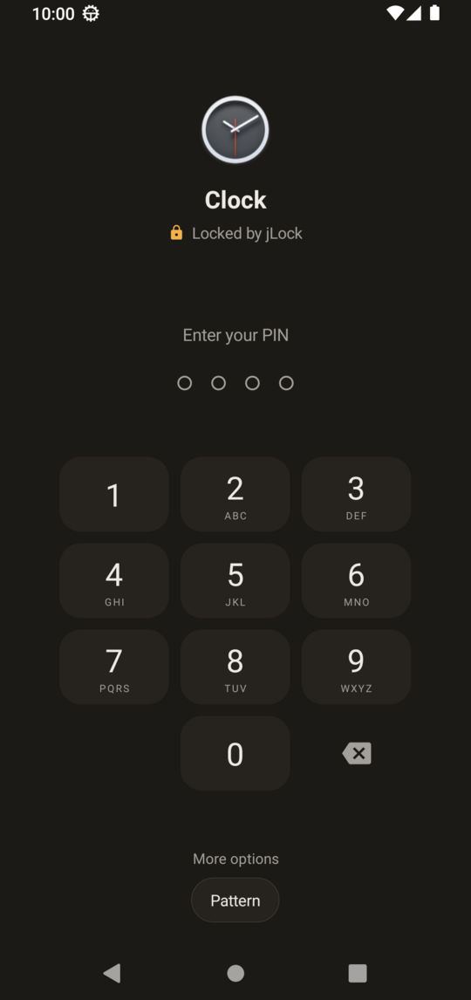
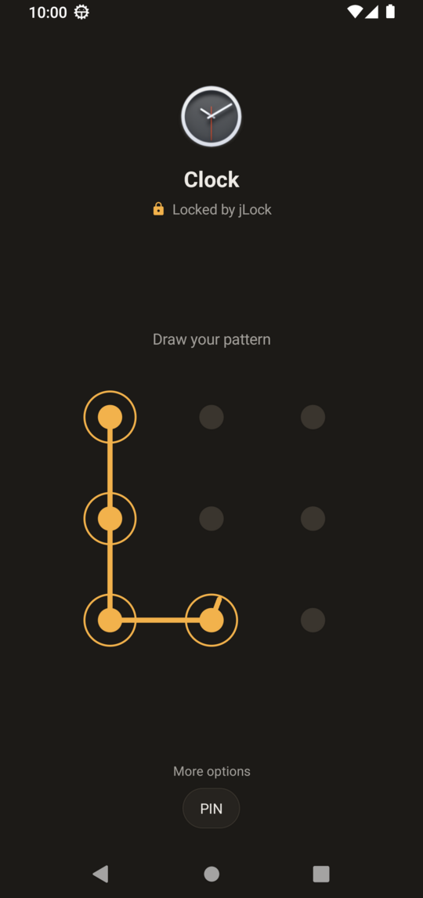
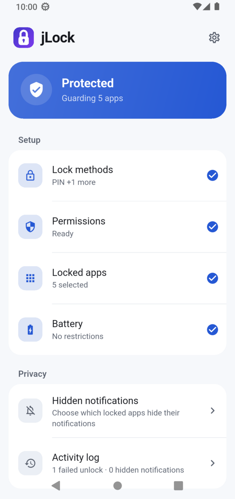
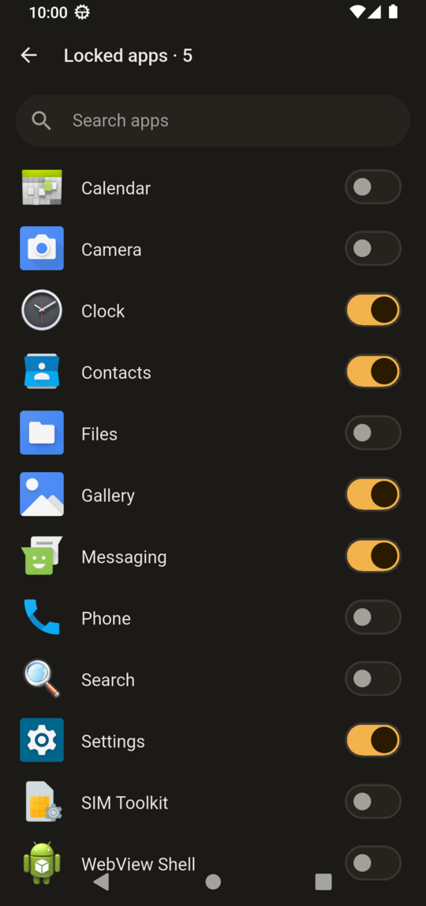
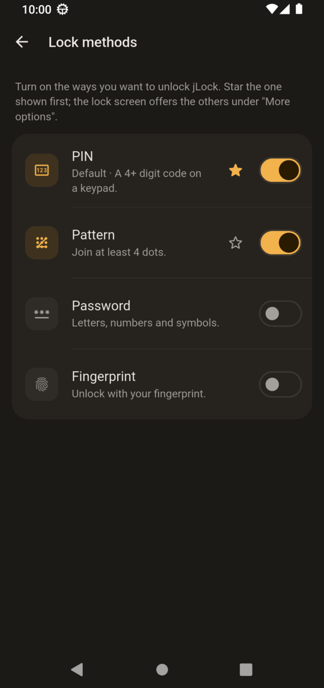
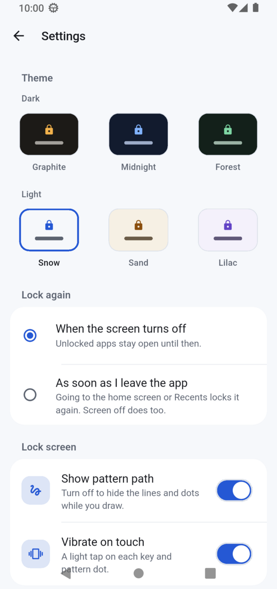

<p align="center">
  
</p>

<h1 align="center">jLock</h1>

<p align="center">
  A light, offline app lock for Android.<br>
  The lock is up before the app shows, with no ads and no internet.
</p>

<p align="center">
  <a href="https://github.com/JulfikarHDinar/jlock/releases/latest"></a>
  
  
  <a href="LICENSE"></a>
</p>

<p align="center">
  
  
  
</p>
<p align="center">
  
  
  
</p>

## Features

- **Lock any app** with a PIN, pattern, password or fingerprint. Star the one shown first; the others are one tap away under "More options".
- **Fast:** the lock screen is drawn by native code that is always ready, so it shows before the app does.
- **Lock again** when the screen turns off, or as soon as you leave the app.
- **Locks itself:** nobody can open jLock to change your locked apps without unlocking it first.
- **Wrong guesses slow down:** after 5 wrong tries jLock makes you wait 30 seconds, then longer with each miss (up to 5 minutes). Changing the phone's clock or restarting the app doesn't skip the wait.
- **Hidden notifications:** pick locked apps whose notifications show only "New notification". Sound and vibration still work.
- **Activity log** of failed unlocks and hidden notifications.
- **System popups keep working:** Bluetooth, Wi‑Fi and other quick prompts from Settings are never covered, even when Settings is locked.
- **Six themes:** three dark, three light.
- **Private and light:** no account, no ads, no tracking, and no internet permission.

## Install

1. On your phone, open **[the latest release](https://github.com/JulfikarHDinar/jlock/releases/latest)** and download `jlock-<version>.apk`.
2. Open the file. If Android asks, allow your browser or Files app to install unknown apps, then tap **Install**. jLock needs Android 11 or newer.
3. Open jLock and follow the four setup steps: create your lock, allow jLock to work, choose apps, and remove battery restrictions.

**Accessibility or notification access greyed out?** Android blocks these switches for apps installed from a file. Open **Settings › Apps › jLock**, tap **⋮** (top right) › **Allow restricted settings**, then try again. jLock's Permissions page has a button that takes you there.

**Updating:** in jLock, open **Settings › Check for updates**. It opens this project's latest release in your browser and shows which version you have. If the release is newer, download it and install it over the old one. Your lock and locked apps stay.

## Two ways to watch apps

jLock needs to know which app is in front. You choose how, under **Permissions**:

| | Usage Access (default) | Accessibility |
|---|---|---|
| Speed | Lock up in about 0.1 s | Lock up in under 0.1 s |
| Banking apps | Keep working | Some refuse to open while any accessibility service is on |
| Chat heads (like Messenger's) | Not covered | Locked too |
| Locked Settings | Shows for about 0.3 s before the lock | Locked at once |
| Runs | A small background service with a status notification (you can hide it) | Inside Android's accessibility system |

You can switch at any time.

## Permissions

| Permission | Why |
|---|---|
| Usage access *(Usage Access mode)* | Sees which app is in front. |
| Display over other apps *(Usage Access mode)* | Shows the lock screen over a locked app. |
| Accessibility *(Accessibility mode)* | Sees which app is in front and draws the lock over it. It does not read, store or send what's on your screen. |
| Notification access *(optional)* | Hides the notifications of apps you pick. |
| Notifications | Shows the "New notification" stand-ins and the Usage Access status notification. |
| See all apps | Lists your apps so you can pick which to lock. |
| Fingerprint | Unlocks with Android's own fingerprint prompt. jLock never sees your fingerprint. |
| Run at startup | Starts the lock as soon as the phone is unlocked after a restart. |
| Ignore battery optimization | Asks Android not to put the lock to sleep. |

jLock has no internet permission.

## Privacy

Everything stays on your phone. jLock stores your PIN, pattern and password only as salted one-way hashes, wrapped with a key in your phone's secure hardware, so they can't be read back. Its data is excluded from cloud backups. Read the [privacy policy](PRIVACY_POLICY.md).

## Good to know

- **Forgot your lock?** Restart the phone in safe mode (jLock doesn't run there), then uninstall jLock from **Settings › Apps**. Your other apps and their data aren't touched.
- **jLock is a privacy lock, not anti-theft.** Anyone who can unlock your phone can still uninstall jLock from the home screen. Lock Settings to make it harder to turn jLock off.
- **Recents** may still show a thumbnail of an app you unlocked earlier. Opening it from Recents asks for your lock again.
- **Phone makers** like Samsung, Xiaomi and Oppo can stop background apps. If the lock ever stops, open jLock and check that **Battery** says "No restrictions".

## Build from source

You need Flutter 3.47 or newer, JDK 17 and the Android SDK (platform 36).

```bash
flutter pub get
flutter run      # on a connected phone or emulator
flutter test
```

The app is Flutter for its screens and native Kotlin for the lock itself (`android/app/src/main/kotlin`), so no Flutter engine starts when a locked app opens.

- [Releasing](docs/RELEASING.md): signing, version numbers and publishing an APK.

## Changelog

See [CHANGELOG.md](CHANGELOG.md).

## License

[MIT](LICENSE) © 2026 JulfikarHDinar
